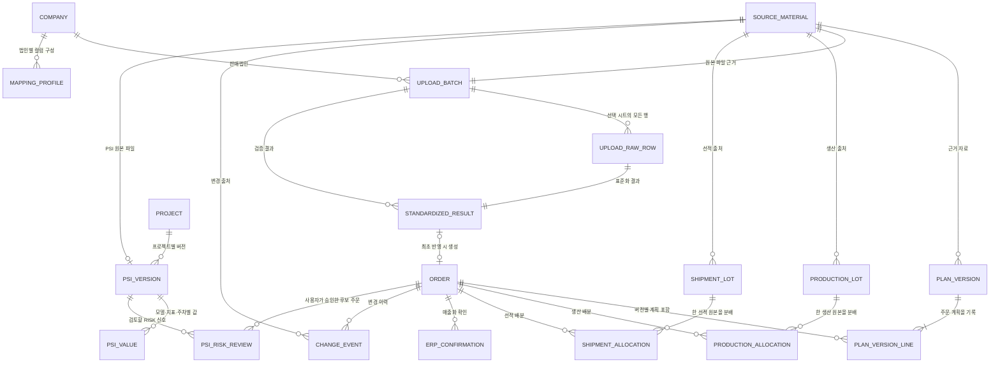

# 데이터 모델 설계

업무 개념과 필드 원칙은 [README.md](README.md)의 6~9절을 따릅니다. 현재 PostgreSQL 16.15에서 데모 주문과 판매자료 원본·표준화·반영 이력을 저장합니다. 다중 사용자 권한, 운영용 파일 저장소와 감사 추적 보안은 이후 확장해야 합니다.

## 관계 개요

## 엔터티와 주요 필드

| 엔터티 | 목적 | 필드 예시 및 규칙 |
|---|---|---|
| `Order` (주문) | 영속 주문 기준 | 안정된 내부 ID, 판매법인 ID, 대상 월, PO/라인(문자열), 모델, 고객, 계획 수량, 순매출/총매출, 통화, 가격 방식, 생산법인 ID, 상태 |
| `PlanVersion` (판매계획 버전) | 자료 단위 계획 스냅숏 구분 | 버전 ID, 원본 자료 ID, 판매법인, 기준일, 전체 현황/변경분, 적용 범위, 생성 시각 |
| `PlanVersionLine` (버전별 계획 행) | 각 버전에 담긴 주문 계획 | 버전 ID, 주문 ID, 수량·금액, 원본 행 식별자, 변경 유형. 행 번호는 식별자가 아님 |
| `SourceMaterial` (원본 자료) | 수신 근거의 추적 | 파일명, 내용 해시, 수신일과 설명. 현재 판매자료 파일 바이너리는 연결된 `UploadBatch`에 보존하며 운영용 별도 파일 저장소는 후속 구현 |
| `UploadBatch` (업로드 배치) | 원본 파일과 사용자가 선언한 범위 보존 | 자료 유형(판매계획/생산정보/선적정보), 파일 바이너리·해시·파일명, 판매계획의 판매법인, 생산·선적정보의 생산법인(판매법인은 파일 내 복수값이므로 비움), 기준일과 여기서 자동 산정한 대상 월, 전체 현황/변경분, 적용 범위, 선택 시트·헤더, 매핑·가격 구분, 상태, 최신 등록자·등록시각. 프로젝트·자료유형·파일 해시 조합은 유일함 |
| `Company` (법인 기준정보) | 판매·생산법인 선택값 | 기본 법인은 모든 프로젝트에서 사용하고, 사용자가 직접 추가한 법인은 `project_id`로 현재 프로젝트에만 노출. 프로젝트 사본 생성 시 새 ID로 복제 |
| `MappingProfile` (매핑 프로필) | 같은 법인·같은 헤더 구성의 확인된 매핑 재사용 | 판매법인 ID, 헤더 서명, 헤더 목록, 표준 컬럼 위치, Net/Gross 단가·총액 구분. 통화는 저장하지 않고 USD 공통값을 사용하며, AI 추천도 사용자가 확인한 최종 매핑만 저장. 헤더 구성이 달라지면 다른 프로필로 취급 |
| `UploadRawRow` (원본 행) | 선택 시트의 모든 데이터 행 추적 | 배치 ID, 시트, 원본 행 번호, 셀 값 목록, 수식 계산값 누락 위치, 병합셀 하위 위치, 처리·제외·오류·검토 상태와 근거 |
| `StandardizedResult` (표준화 결과) | 원본 행을 표준 주문 항목으로 변환한 결과 | PO/라인 문자열, 모델·고객, 수량, Net/Gross 원본값과 환산 총액, 통화, 생산사이트, 판매지역, 검증 상태·근거, 반영 주문 ID |
| `ProductionLot` (생산 물량) | 예정과 실제 생산 정보를 독립 보존 | 원본 ID, 사이트, 모델/고객/가능한 PO, 생산 예정/완료 날짜, 예정/완료 수량 및 각 상태 |
| `ShipmentLot` (선적 물량) | 예정과 실제 선적 정보를 독립 보존 | 원본 ID, ETD, 예정/실제 수량, 선사·선박·항차 등 확인된 필드. 기존 ETA DB 값은 호환용으로만 보존하고 현재 화면·입력·내보내기에는 사용하지 않음 |
| `ProductionAllocation` / `ShipmentAllocation` (물량 연결) | 원본 물량과 주문 사이의 단계별 배분 | 상세 ID, 주문 ID, 원본 물량 ID, 배분수량, 검토상태, 근거. 동일 단계 배분 합계는 원본 가용수량을 초과하지 않음 |
| `ERPConfirmation` (ERP 확인) | 매출화 상태를 근거로 확인 | 주문 ID, 상태(미확인/미완료/일부/완료/취소·정정), 확인 수량·금액·통화·일자·문서번호, 확인자, 근거 |
| `ChangeEvent` (변경 이력) | 변경 전후와 원본 근거 기록 | 주문 ID, 이벤트 시각, 변경 필드, 이전/이후 값, 이벤트 유형, 원본 자료 ID, 확인자 |
| `PsiVersion` (PSI 버전) | 업로드한 PSI 원본과 검토·승인 상태 보존 | 프로젝트 ID, 원본 ID, 원본 파일명에서 자동 설정한 버전 이름, 기준월, 자료 기준일, 등록자, 파일명·해시·바이트, 시트명, 검증 문제, 검토 대기/검증 보류/승인 상태, 승인자·승인시각 |
| `PsiValue` (PSI 주차 값) | 모델별 DM·SA·SP·Inventory·Warehouse 원본 셀 보존 | PSI 버전 ID, 판매법인, 생산법인, 모델, 지표, `YYYY-MM-Wn` 주차 키, 0 이상 정수 수량, 원본 행·열 위치. 버전·차원·주차 조합은 중복 불가 |
| `PsiRiskReview` (PSI 주문 RISK 검토) | 모델 단위 신호를 사용자가 확인한 주문에만 연결 | PSI 버전·프로젝트 ID, 판매법인, 생산법인, 모델, 주차, 신호 유형, 영향수량, 근거, 검토 대기/승인/보류 상태, 선택 주문 ID, 검토자·시각·메모 |
| `OrderManualOverride` (수동 우선값) | 사용자가 직접 저장해 자동 업로드보다 우선할 주문 필드 보존 | 주문·프로젝트 ID, 보호 필드 목록, 마지막 수정자·수정시각. 프로젝트 사본에는 독립된 보호 행으로 복사 |
| `OrderUpdateProposal` (업데이트 검토) | 후속 파일과 현재 주문의 차이를 자동 반영 전 보류 | 주문·배치·표준화 결과·출처 ID, 새 파일 값, 필드별 현재값·새값·수동 우선 여부, 검토 상태·처리자·처리시각 |

## 프로젝트 생성·사본·영구 삭제

- 빈 프로젝트는 `Project`와 소유자의 `ProjectMember`만 만들며 주문·업로드·PSI 자료를 복제하지 않습니다. 프로젝트 생성 후 현재 프로젝트 쿠키를 새 ID로 전환합니다.
- 사본은 새 `Project` ID와 주문 ID를 사용하고 현재 주문·생산·선적·수동 우선 상태를 복사합니다. 변경되지 않는 출처는 기존 `SourceMaterial`을 함께 참조할 수 있으므로 사본 수정이 원본 주문을 바꾸지 않습니다.
- `project_service.py`가 프로젝트 삭제 순서를 한 곳에서 관리합니다. RISK 배분·검토·PSI 값, 버전 행·변경 이력·ERP 확인·생산·선적·수동값·주문, 표준화 결과·원본 행·업로드, PSI·비정형 원본, 멤버십과 프로젝트 순으로 한 트랜잭션에서 삭제합니다.
- 삭제한 프로젝트를 원본으로 표시하던 사본의 `copied_from_id`는 비우되 사본 자체는 유지합니다. 삭제 후에도 다른 프로젝트에서 참조하는 `SourceMaterial`은 보존하고, 참조가 완전히 사라진 원본만 삭제합니다.
- 프로젝트 삭제에는 프로젝트 소유자 권한과 정확한 프로젝트 이름 재입력이 필요합니다. 마지막 프로젝트는 계정 접근 불능을 막기 위해 삭제할 수 없습니다.

## 집계 규칙과 데모 사례

- 주문 요약 수량과 금액은 `Order`의 계획 한 건에서 집계합니다. 주문→생산 상세와 주문→선적 상세를 한 조인 결과에서 합산하지 않습니다.
- 생산 완료와 실제 선적은 서로 다른 단계입니다. 주문 20대의 생산 배분 15+5대와 선적 배분 10+10대는 각각 단계 내에서 20대이며, 생산+선적을 주문 40대로 해석하지 않습니다.
- 예정 수량과 실제 완료 수량을 중복해 더하지 않습니다. 프로젝트 기준 날짜보다 과거인 PST가 최신 파일에 유지되고 안전하게 연결된 자동 업로드 행은 별도 완료 플래그가 없어도 해당 수량을 실제 완료로 표시합니다.
- 현재 Sales Master 업무 통화는 USD 하나입니다. 판매자료의 통화 컬럼은 매핑하지 않고 표준화 결과에 USD를 명시합니다. 다른 통화를 지원하려면 환율·환산 기준을 먼저 설계하며, 단가를 총액으로 바꾸는 것은 가격 방식과 수량을 확인했을 때만 합니다.
- 대시보드 매출완료금액은 `ERPConfirmation.confirmed_quantity`의 주문금액 비례분, 배송중 금액은 실제 선적수량 중 아직 매출완료되지 않은 수량의 비례분입니다.
- 매출 대기는 주문금액에서 매출완료금액을 뺀 값이고, 매출예상금액은 실제 선적 또는 선적 예정 상세가 하나라도 있는 주문의 전체 금액입니다.
- PO 및 원본 식별자는 문자열로 저장합니다. PO 앞자리 0을 보존합니다.
- 주문 변경·취소, 매출화 확인 정보 누락, 연결 검토는 기록에서 삭제하지 않고 상태 또는 변경 이력으로 남깁니다.
- `ERPConfirmation`은 판매자료 버전과 독립된 확정 실적입니다. 새 판매자료의 누락·변경만으로 기존 Closed 기록이나 누적 수량을 삭제·초기화하지 않으며, 근거 있는 취소·정정 기록만 별도 이력으로 처리합니다.
- 모호한 연결의 기본 상태는 `검토 필요`입니다. 이 단계에서는 자동 매칭을 수행하지 않습니다.

## 생산·선적 진행 요약과 PSI 파생 규칙

- Sales Master의 생산·선적 일정 칸은 저장된 `ProductionLot`·`ShipmentLot`과 연결 수량에서 계산합니다. 자동 업로드된 안전한 연결은 프로젝트 기준 날짜와 PST·ETD를 비교해 각각 예정 또는 생산·선적 완료로 표시합니다.
- 완료수량은 실제 상태의 연결 수량만, 예정수량은 예정 상태의 연결 수량만 합산합니다. `미완료 = 주문수량 - 완료수량`이며, `이월 가능 = 주문수량 - 완료수량 - 예정수량`의 0 이상 값입니다.
- 예정 상세가 있으면 가장 빠른 예정일을 대표 예정일·다음 일정으로 표시합니다. 미완료 수량이 있는데 예정 상세가 없으면 `일정 미정`으로 표시하며 임의의 날짜를 만들지 않습니다.
- 생산 예정일은 PST, 선적 예정일은 ETD로 표시하고 서로 다른 필드에 저장합니다. 분할 Shipment마다 ETD·선사명·선박명을 보존합니다. 기존 ETA 필드는 마이그레이션 호환을 위해 DB에만 남기고 현재 기능에서는 읽거나 수정하지 않습니다.
- `ProductionAllocation`은 생산정보 자료 기준일보다 PST가 과거이고 최신 파일에 그 행이 유지되면 `실제 완료`로 저장합니다. 자료 기준일 당일·미래 PST, AI 검토 후보와 모호한 연결은 `예정` 또는 `검토 필요`로 둡니다. 완료로 확정한 부분 생산 행은 다른 예정 행이 바뀌거나 후속 파일에서 빠져도 유지합니다.
- 사용자가 수정한 생산·선적 상세에는 `is_manual=true`를 저장합니다. 후속 자동 매칭은 이를 덮어쓰지 않고 `OrderUpdateProposal`로 차이를 제시해야 합니다.

## Sales Master 수동 우선과 후속 파일 비교

- 수동 저장은 주문 내부 ID를 유지한 채 주문 필드와 생산·선적 상세를 변경하고 별도의 수동 원본 및 `ChangeEvent`를 남깁니다. `OrderManualOverride.protected_fields`가 자동 갱신 금지 범위를 나타냅니다.
- 주문 수량을 생산 완료+예정, 선적 완료+예정 또는 ERP Closed 누계보다 작게 저장할 수 없습니다. 생산 실제 완료는 과거 PST, 실제 선적은 과거 ETD를 각각 완료일 근거로 사용할 수 있습니다. ETA만으로 실제 선적을 저장하지 않습니다.
- 후속 판매자료는 판매법인·PO·모델·고객 및 제공된 PO라인이 일치하는 후보가 정확히 하나이면 규칙으로 차이를 계산합니다. 규칙으로 유일하게 찾지 못한 경우 OpenAI가 최소 표준 식별정보로 동일 물량 후보를 추천할 수 있지만, 중간 이상 신뢰도의 추천도 `업데이트 검토`만 만들고 주문을 자동 변경하지 않습니다.
- 변경 제안은 주문을 자동 수정하지 않습니다. 사용자가 체크한 필드만 새 파일 값으로 반영하며 선택하지 않은 필드와 생산·선적 실적은 그대로 둡니다. 새 파일 값을 수락한 필드는 수동 보호 목록에서 해제합니다.
- 생산·선적정보 자동 매칭은 PO·모델·행별 판매법인 중 둘 이상의 식별 신호로 후보를 좁히고 후보가 정확히 하나이며 같은 단계의 기존 연결 합계와 새 수량이 주문 수량을 넘지 않을 때만 연결합니다. 생산은 프로젝트 기준 날짜보다 과거 PST를 `실제 완료`, 선적은 과거 ETD를 `실제 선적`으로 표시하고 당일·미래 일정은 `예정`으로 둡니다. ETD·선사·선박은 별도 `ShipmentAllocation`에 보존합니다.
- 규칙으로 단일 후보를 찾지 못하고 OpenAI 키가 설정된 경우 파일 전체 대신 최소 표준 식별정보와 최대 20개의 프로젝트 내부 주문 후보를 전송합니다. AI가 제안한 연결은 `검토 필요` 상태의 단계별 Allocation으로만 저장하며 주문 가용수량을 차감하지 않고 실제/예정 확정 집계에도 포함하지 않습니다. 사용자가 수동으로 확인하기 전에는 생산법인도 확정하지 않습니다.
- PSI는 별도 원본 테이블이 아직 없는 기초 단계이므로 Sales Master 주문을 판매법인·생산법인·모델별로 묶어 화면에서 파생합니다. 기준 기간은 현재 월의 과거 3개월부터 미래 8개월까지이고 월별 7일 단위 W1~W5를 사용합니다.
- 데모 PSI의 DM은 주문 대상 월, SA는 생산 예정·완료 연결, SP는 선적 예정·완료 연결, Warehouse는 실제 생산 완료, Inventory는 `이전 재고 + SA - SP` 누계로 계산합니다. 기초재고는 0인 합성 기준이며 실제 PSI 원본이나 확정 판매할당으로 오해하지 않도록 화면과 Excel에 표시합니다.
- PSI 업로드는 A:D의 판매법인·생산법인·모델·구분과 E열 이후 연월/W1~W5 이중 헤더를 검증합니다. 병합된 연월 헤더만 명시적으로 이어받고 일반 수량 셀은 아래로 복사하지 않습니다.
- PSI 기준월은 별도 사용자 입력을 받지 않고 자료 기준일의 `YYYY-MM`로 계산하여 두 값의 불일치를 방지합니다.
- 동일 프로젝트의 같은 PSI 파일 해시는 기존 버전 ID를 유지한 채 파일명·자료 기준일·기준월·등록자·등록시각·원본과 다시 파싱한 값을 최신 입력으로 교체합니다. 변경된 기준으로 RISK를 다시 계산해야 하므로 검토 상태에서 다시 시작합니다. 새 버전은 업로드 시점보다 앞선 가장 최근 승인본과 안정된 `판매법인+생산법인+모델+지표+주차` 키로 비교합니다. 승인본이 없으면 최초 버전으로 저장합니다.
- 승인은 PSI 상태만 바꾸며 Sales Master 주문, 생산·선적 실적을 만들거나 변경하지 않습니다.
- RISK 검토 신호는 기준 주차까지의 누적 `DM-SA`와 `SA-SP` 양수 차이입니다. 단계별 부족분을 각각 표시하며 두 차이를 서로 합산하거나 최종 위험으로 자동 확정하지 않습니다.
- PSI에는 PO가 없으므로 판매법인·생산법인·모델이 모두 같은 주문만 후보로 보여 줍니다. 후보가 하나여도 서버가 자동 승인하지 않으며 사용자가 주문을 선택해야 합니다. 후보가 없거나 모호하면 보류합니다.
- 승인된 PSI 신호는 Sales Master의 RISK 근거와 영향수량에 포함하지만 주문수량, 생산·선적 수량, 주문금액은 바꾸지 않습니다. 여러 단계의 영향수량은 더하지 않고 가장 큰 영향수량을 표시합니다.

## 판매자료 처리 상태와 반영 규칙

`검사 완료 → 검증 완료/검증 보류 → 반영 완료/버전 비교 대기` 순서로 상태가 이동합니다.

- 파일 업로드 시 원본 파일과 배치만 저장합니다. 이 시점에는 주문을 만들지 않습니다.
- 시트·헤더·매핑을 확정하면 선택 시트의 모든 행과 표준화 결과를 저장합니다.
- `처리` 행만 반영 후보입니다. `오류` 또는 `검토` 행이 하나라도 있으면 전체 반영을 막아 부분 저장을 방지합니다. `제외` 행도 근거와 함께 보존합니다.
- 최초 자료의 반영 버튼은 하나의 DB 트랜잭션 안에서 주문, 판매계획 버전, 버전 행과 변경 이력을 함께 생성합니다.
- 같은 프로젝트·자료유형의 같은 파일 해시는 생산정보·선적정보일 때 기존 배치 ID를 유지하고 메타데이터·원본·파싱 결과를 최신 입력으로 교체합니다. 같은 원본을 생산정보와 선적정보로 각각 등록하는 것은 허용합니다. 판매계획과 같은 배치의 반영 재호출은 기존 중복 방지 결과만 반환합니다.
- 같은 법인·대상 월에 이미 업로드 주문이 있거나 주문 존재 여부가 모호하면 주문을 추가하거나 덮어쓰지 않고 `버전 비교 대기`로 보존합니다.
- 원본 수량과 금액은 USD 기준으로 대사합니다. Net/Gross의 `단가`는 수량을 곱해 총액으로, `총액`은 그대로 대사합니다. 컬럼이나 값이 없으면 `대사 불가`와 그 이유를 표시합니다.

## 업로드 영구 삭제 공통 구조

- 보존 원칙은 사용자가 삭제하지 않은 자료에 적용합니다. 사용자가 파일명·자료 유형·기준일과 복구 불가 안내를 확인한 PSI·생산정보·선적정보는 상태와 관계없이 즉시 영구 삭제하며 soft delete, 휴지통, 삭제 감사행을 만들지 않습니다.
- `upload_deletion.py`가 삭제 진입점을 한 곳에 모읍니다. PSI는 `PsiValue → PsiRiskAllocation → PsiRiskReview → ChangeEvent → PsiVersion → SourceMaterial` 순서의 종속 관계를, 정형 업로드는 `ProductionAllocation/ShipmentAllocation/ChangeEvent → StandardizedResult → UploadRawRow → UploadBatch → SourceMaterial` 관계를 한 DB 트랜잭션에서 정리합니다. 비정형 입력도 SourceMaterial과 원본 바이트를 함께 삭제합니다.
- 법인·헤더 구성별로 재사용하는 `MappingProfile`은 특정 업로드의 소유물이 아니므로 삭제하지 않습니다. 배치에 직접 저장된 `mapping_json`과 가격 방식, 원본 행·표준화 결과는 배치와 함께 삭제합니다.
- 생산정보·선적정보·PSI 삭제에서는 `Order`, 주문 수량·금액·PST·ETD·ETA와 `ERPConfirmation` 확정값을 보존합니다. 판매계획 삭제는 예외로, `Order.upload_batch_id` 또는 그 배치의 `upload_result_id`가 직접 가리키는 주문만 골라 생산·선적 상세, ERP Closed, 수동 우선값, 변경 제안·이력과 함께 삭제합니다.
- 판매계획 삭제 시 해당 주문에 승인·배분된 PSI RISK 연결은 제거하고 PSI 신호는 `검토 대기`로 되돌립니다. PSI 원본 값과 다른 후보 주문은 유지합니다. 주문에 연결된 별도 수동 원본은 다른 참조가 없을 때만 정리합니다.
- 다른 업로드가 공유하지 않는 해당 원본의 생산·선적 배분과 PSI RISK 근거만 끊습니다. 이후 자동 매칭으로 새 원본 종속 연결 테이블을 추가할 때는 공통 삭제 대상 목록에 모델을 등록하여 같은 규칙을 적용합니다.
- 삭제 API는 로그인 사용자와 현재 프로젝트 ID를 함께 검사합니다. 삭제 후 원본 다운로드·PSI 내보내기 조회는 대상 행이 없으므로 404를 반환합니다. 승인 PSI를 삭제하면 남은 승인본 중 업로드 시점보다 앞선 가장 최근 버전을 비교 기준으로 다시 선택합니다.

## 구현 제약

PostgreSQL에서 판매자료 파일·행·표준화 결과 저장, 최초 주문 반영, 파일/반영 요청 중복 방지와 재시작 보존을 확인했습니다. 현재 파일 바이너리는 DB에 저장하므로 운영 규모에서는 별도 객체 저장소와 백업 정책이 필요합니다. 판매계획 버전 간 증감·이동 비교, 동시 물량 배분 한도와 운영 백업·복원은 후속 단계에서 구현하고 검증합니다. 기존 SQLite 파일은 보존되지만 기본 실행 저장소로 사용하지 않습니다.
